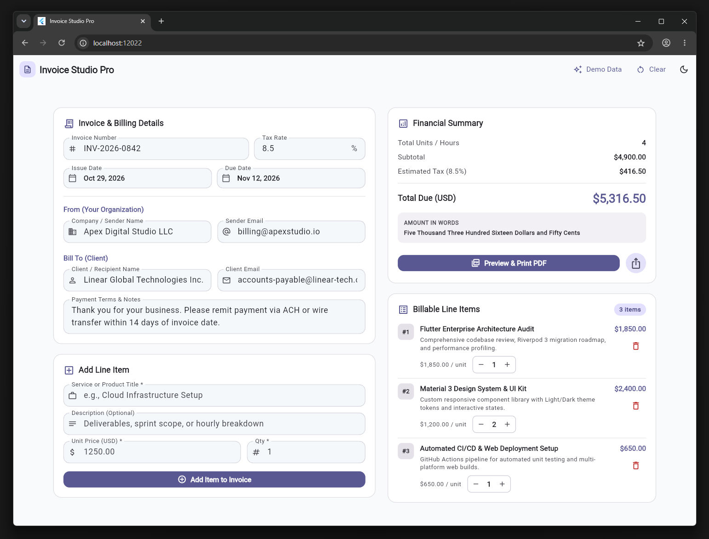
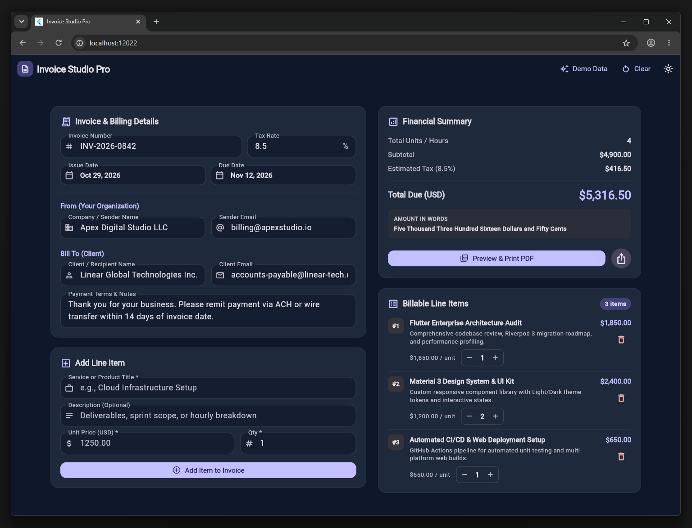
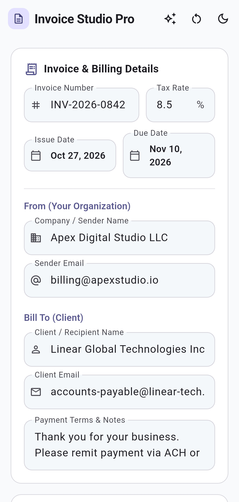
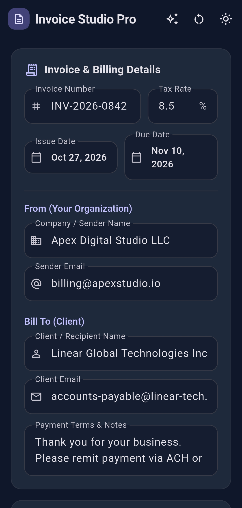
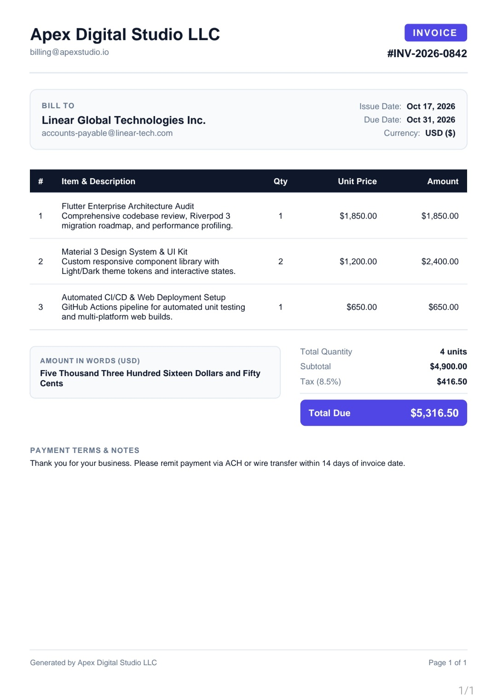
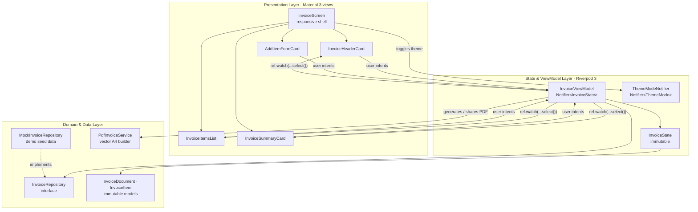

<div align="center">

# Invoice Studio Pro

**A responsive B2B invoice & billing studio built with Flutter, Riverpod 3 and Material 3.**

Real-time calculations · Vector PDF export · Feature-first MVVM · One codebase for Web, Android, iOS and Desktop

[](https://github.com/erfaanparsa/invoice-studio-pro/actions/workflows/flutter_ci_cd.yml)
[](https://flutter.dev)
[](https://dart.dev)
[](https://riverpod.dev)
[](https://m3.material.io)

[](LICENSE)

### [**▶ Launch the Live Web Demo**](https://erfaanparsa.github.io/invoice-studio-pro/)

[Screenshots](#screenshots) · [Features](#features) · [Architecture](#architecture) · [Tech Stack](#tech-stack) · [Getting Started](#getting-started) · [CI/CD](#cicd) · [License](#license)

</div>

---

## Screenshots

### Web

<table>
  <tr>
    <td align="center"><b>Light theme</b></td>
    <td align="center"><b>Dark theme</b></td>
  </tr>
  <tr>
    <td></td>
    <td></td>
  </tr>
</table>

### Android

<table>
  <tr>
    <td align="center"><b>Light theme</b></td>
    <td align="center"><b>Dark theme</b></td>
    <td align="center"><b>PDF preview</b></td>
  </tr>
  <tr>
    <td></td>
    <td></td>
    <td></td>
  </tr>
</table>

> [!TIP]
> **Recruiter Demo Mode:** the app launches pre-populated with realistic B2B consulting line items, so you can evaluate the calculations and the PDF output immediately, with no manual data entry.

---

## About

Invoice Studio Pro is a commercial-style **B2B invoice generation and billing studio**. It lets you build an invoice line by line, watch subtotals, tax and totals update instantly, and export a print-ready A4 PDF on any supported platform.

The project is also a reference implementation of **Riverpod 3.x** state management inside a strict **Feature-First MVVM** architecture, with every layer kept small, immutable and testable.

---

## Features

- **Invoice workspace**: edit invoice header details, add line items, and review a live summary in one screen.
- **Automated accounting engine**: unit quantities, subtotals, configurable percentage tax rates, USD (`$`) formatting, and an English number-to-words conversion for the total.
- **Cross-platform vector PDF engine**: built on `pdf` and `printing` with no unguarded `dart:io` usage. Multi-page A4 pagination, real-time print preview, and native or browser PDF downloads on Web, Android, iOS, macOS and Windows.
- **Adaptive Material 3 UI**: a two-column split workspace on Desktop and Web (`>= 900px`) that collapses into an ergonomic single-column layout on mobile, with instant Light/Dark theme switching.
- **Rebuild-efficient state**: built exclusively with `Notifier` and `NotifierProvider`, using granular `ref.watch(...select(...))` subscriptions so typing in the form or editing a line item does not rebuild unrelated widgets.
- **Swappable data layer**: views depend on the abstract `InvoiceRepository`, so the bundled demo data source can be replaced by a real backend without touching the UI.

---

## Architecture

The app enforces a strict separation of concerns using a **Feature-First MVVM** pattern.



| Layer | Responsibility |
| --- | --- |
| **Presentation** | Material 3 widgets that render state and forward user intents to the ViewModel. |
| **State & ViewModel** | Immutable `InvoiceState` plus Riverpod `Notifier`s that own all business logic and expose granular state slices. |
| **Domain & Data** | Immutable models, the repository abstraction and its demo implementation, and the PDF generation service. |

### Project structure

```text
lib/
├── core/
│   ├── theme/
│   │   ├── app_theme.dart
│   │   └── theme_provider.dart
│   └── utils/
│       ├── formatters.dart
│       └── number_to_words.dart
├── features/
│   └── invoice/
│       ├── models/
│       │   ├── invoice_document.dart
│       │   └── invoice_item.dart
│       ├── repositories/
│       │   └── invoice_repository.dart
│       ├── services/
│       │   └── pdf_invoice_service.dart
│       ├── view_models/
│       │   └── invoice_view_model.dart
│       └── views/
│           ├── screens/
│           │   └── invoice_screen.dart
│           └── widgets/
│               ├── add_item_form_card.dart
│               ├── invoice_header_card.dart
│               ├── invoice_items_list.dart
│               └── invoice_summary_card.dart
└── main.dart
```

---

## Tech Stack

| Category | Technology | Purpose |
| --- | --- | --- |
| Framework | Flutter 3.29+ (Dart 3.7+) | Cross-platform UI toolkit for Web, Android, iOS and Desktop |
| State management | `flutter_riverpod` ^3.0.0 | Reactive, compile-safe state management and dependency injection |
| PDF engine | `pdf` ^3.11.1 | Pure Dart vector PDF page layout and multi-page table rendering |
| Print & share | `printing` ^5.13.4 | Cross-platform native/browser PDF preview, print and share sheet |
| Localization | `intl` ^0.20.2 | Standardized `en_US` currency (`$`) and date (`MMM dd, yyyy`) formatting |
| CI/CD | GitHub Actions | Static analysis, automated tests, APK build and GitHub Pages deployment |

---

## Getting Started

### Prerequisites

- [Flutter SDK](https://docs.flutter.dev/get-started/install) 3.29 or newer (stable channel)
- Chrome for the web target, and Android Studio or Xcode for mobile targets

Run `flutter doctor` to confirm your toolchain is ready.

### 1. Clone and install dependencies

```bash
git clone https://github.com/erfaanparsa/invoice-studio-pro.git
cd invoice-studio-pro
flutter pub get
```

### 2. Run the app

```bash
# Flutter Web (Chrome)
flutter run -d chrome

# A connected Android / iOS device or emulator
flutter run
```

### 3. Analyze and test

```bash
flutter analyze
flutter test
```

### 4. Build for release

```bash
# Web (use --base-href when hosting under a sub-path such as GitHub Pages)
flutter build web --release --base-href "/invoice-studio-pro/"

# Android APK
flutter build apk --release
```

---

## CI/CD

The workflow in [`.github/workflows/flutter_ci_cd.yml`](.github/workflows/flutter_ci_cd.yml) automates the project's quality gates and delivery:

1. Static analysis with `flutter analyze`
2. Unit and widget tests with `flutter test`
3. Android APK build
4. Web build and deployment to [GitHub Pages](https://erfaanparsa.github.io/invoice-studio-pro/)

---

## License

Distributed under the [MIT License](LICENSE). Copyright © 2026 erfaanparsa.

---

## Author

**[@erfaanparsa](https://github.com/erfaanparsa)** — Flutter developer, open to remote and freelance opportunities.

If you find this project useful, a ⭐ on the repository is much appreciated.
